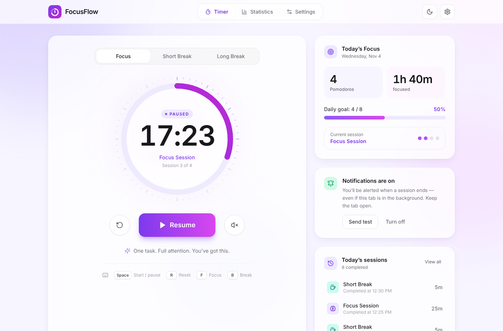
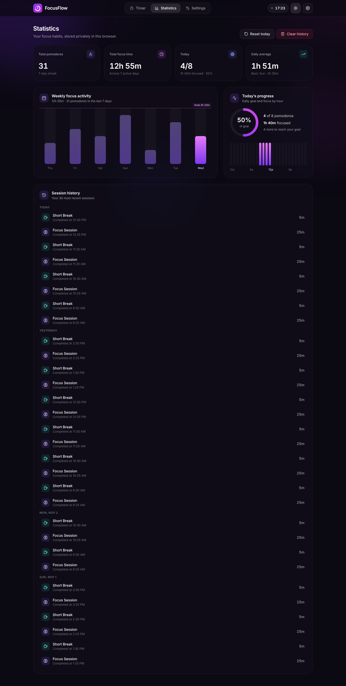
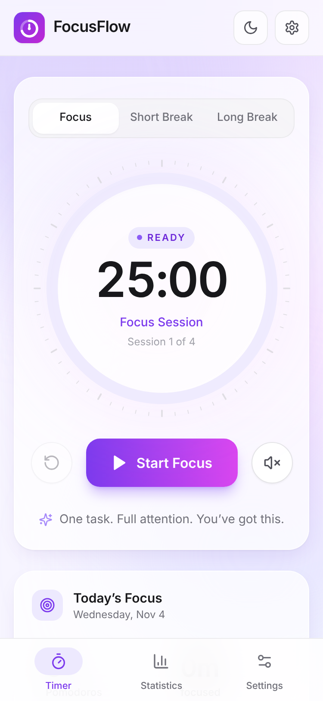
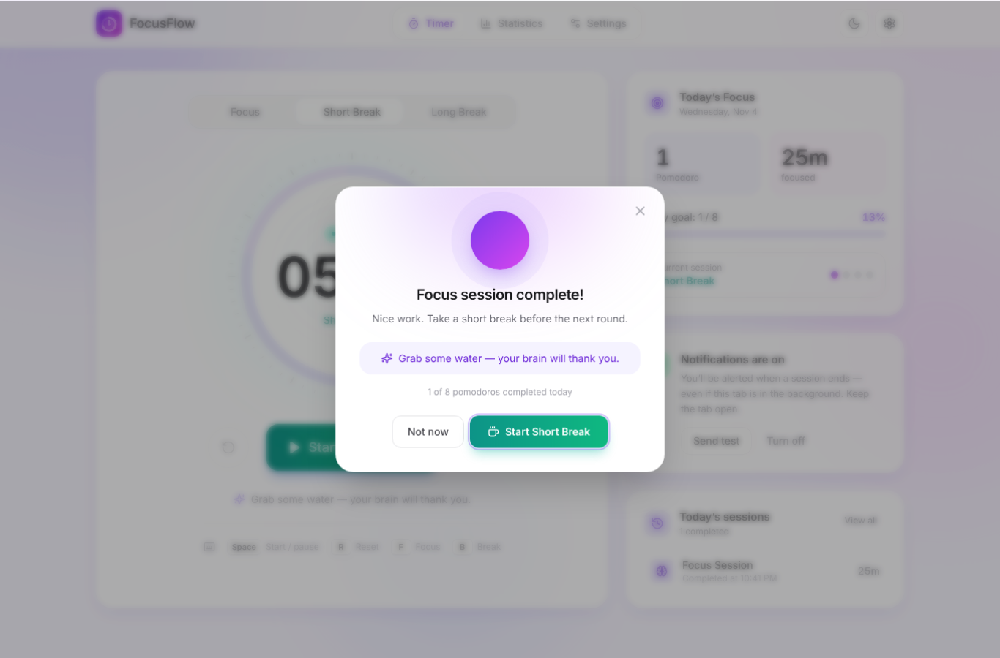

# FocusFlow — Pomodoro Timer with Browser Notifications

A polished, frontend-only Pomodoro productivity app built with **React, Vite and Tailwind CSS**. Focus in 25-minute sessions, take short and long breaks, get native browser notifications when sessions end, and track your progress with daily and weekly statistics. Everything runs in the browser and is saved in LocalStorage, with no account, backend or database.



| Statistics (dark) | Mobile | Session complete |
| --- | --- | --- |
|  |  |  |

## Features

- **Circular SVG timer** with animated progress ring, MM:SS display, session label and cycle position
- **Three modes**: Focus (25m), Short Break (5m), Long Break (15m), shown as segmented tabs
- **Start / Pause / Resume / Reset**, with the live countdown shown in the browser tab title
- **Browser notifications** through the native Notifications API, with every permission state handled
- **Completion modal** with animation, a motivational message and a one-click "start next session" button
- **Optional completion chime** and **ambient brown-noise** toggle, both synthesised with Web Audio (no audio files)
- **Long break after every 4 focus sessions** (configurable)
- **Auto-start** for breaks and/or focus sessions (off by default)
- **Daily goal** with a progress bar, plus today's pomodoros and focus minutes
- **Statistics**: total pomodoros, total focus time, today vs. goal, 7-day average, streak, weekly bar chart, focus-by-hour chart, session history
- **Settings** with validated inputs, persisted to LocalStorage
- **Light and dark mode** that persists and doesn't flash on load
- **Keyboard shortcuts**: `Space` start/pause · `R` reset · `F` focus · `B` break
- **Responsive**: header navigation on desktop, bottom tab bar on mobile, and a timer that always fits the screen
- **Resilient**: survives page refreshes, background-tab throttling, corrupted or unavailable LocalStorage, and multiple open tabs

## Getting started

Requires **Node.js 18+**.

```bash
npm install
npm run dev        # http://localhost:5173
```

Other scripts:

```bash
npm run build      # production build into dist/
npm run preview    # serve the production build
npm test           # unit tests for the timer/stats/storage logic (node:test)
```

> Notifications need a secure context. `localhost` counts as secure, so they work in development. When you deploy, serve the app over HTTPS.

## Project structure

```
├── index.html                 # theme is applied before paint (no flash)
├── public/                    # favicon + PNG icons used by notifications
├── src/
│   ├── App.jsx                # composition: hooks + views + modal + toast
│   ├── main.jsx
│   ├── index.css              # Tailwind layers + component classes
│   ├── constants.js           # modes, defaults, limits, storage keys, messages
│   ├── components/
│   │   ├── Header.jsx, Navigation.jsx, ThemeToggle.jsx, Logo.jsx
│   │   ├── TimerDashboard.jsx, PomodoroTimer.jsx, TimerControls.jsx, SessionTabs.jsx
│   │   ├── ProgressCard.jsx, SessionHistory.jsx, NotificationManager.jsx, CompletionModal.jsx
│   │   ├── StatisticsDashboard.jsx, SettingsPanel.jsx
│   │   └── ui/                # Card, Switch, BarChart, ProgressRing, Toast, mode theme
│   ├── hooks/
│   │   ├── usePomodoroTimer.js   # all timer business logic
│   │   ├── useLocalStorage.js    # persisted + validated + cross-tab state
│   │   ├── useNotifications.js   # permission tracking + notify()
│   │   ├── useTheme.js
│   │   ├── useSessionHistory.js, useKeyboardShortcuts.js, useDocumentTitle.js, useToast.js
│   └── utils/
│       ├── time.js            # formatTime, calculateProgress, calculateFocusTime, getNextSession…
│       ├── timerState.js      # pure start/pause/reset/complete transitions
│       ├── validation.js      # sanitisers for settings, timer and history
│       ├── stats.js           # today / weekly / hourly / streak aggregations
│       ├── storage.js         # safe LocalStorage wrapper with in-memory fallback
│       ├── notifications.js   # Notifications API utility
│       └── sound.js           # Web Audio chime + ambient noise
└── tests/logic.test.js
```

UI components only render. The rules (state transitions, validation, statistics) live in pure functions under `utils/`, which is what the unit tests exercise.

## How the timer works

The timer **does not count ticks**. Browsers throttle `setInterval` in background tabs, sometimes to once a minute, so a tick-counting timer drifts. Instead:

1. When a session starts, the app stores an absolute **`endTime`** (`Date.now() + remaining`).
2. While the session runs, a single 250 ms interval updates `now`, and the display shows `remaining = endTime − now`. If ticks are delayed, the next one still shows the correct time.
3. **Pause** stores `remainingMs` and clears `endTime`. **Resume** sets a new `endTime = now + remainingMs`.
4. On `visibilitychange` and `focus`, the clock re-syncs right away, so a tab you come back to never shows a stale value.
5. When `endTime ≤ now`, the session completes. Each completion gets a stable id (`mode-endTime`), which:
   - prevents duplicate notifications and duplicate history entries (React StrictMode re-runs, reloads, several tabs open);
   - makes history writes idempotent.
6. The timer state (`mode`, `status`, `endTime`/`remainingMs`, `duration`, `cycleCount`) is saved to LocalStorage. After a refresh the session picks up where it left off. If it ended while the page was closed, it completes as soon as the page loads.
7. Only one interval exists, and only while a session is running. It is cleared when the session stops and when the component unmounts. Open tabs share the same state through the `storage` event, so two timers can never run independently.

After a focus session, the cycle count goes up. Once it reaches the long-break interval (default 4), the next session is a long break. Finishing a long break resets the cycle. The next session starts automatically **only** if auto-start is turned on in Settings.

## Browser notifications

`src/utils/notifications.js` wraps the [Notifications API](https://developer.mozilla.org/docs/Web/API/Notifications_API):

| Permission | What the app does |
| --- | --- |
| unsupported | Explains that notifications aren't available. In-app alerts and sound still work. |
| `default` | Shows **Enable notifications**. Permission is requested **only** when you click it, never on page load and never more than once. |
| `granted` | Lets you turn notifications on/off and send a test notification. |
| `denied` | Shows step-by-step instructions for allowing notifications in the browser's site settings. |

Permission is re-checked when the window regains focus and through `navigator.permissions` change events, so changes made in browser settings show up without a reload.

Messages:
- Focus done: **"FocusFlow — Focus session completed! Time for a break."**
- Break done: **"Break Complete — Your break is over. Ready to focus again?"**

**Limitations:** notifications work while the page is open, including when the tab is in the background or the window is minimised. They **cannot** be delivered after the tab or browser has been closed, because there is no push server. In heavily throttled background tabs, a notification may arrive a few seconds late, but the recorded time and statistics stay exact.

## LocalStorage

| Key | Contents |
| --- | --- |
| `focusflow:settings` | durations, long-break interval, daily goal, notification/sound/auto-start preferences |
| `focusflow:timer` | current mode, status, `endTime` or `remainingMs`, duration, cycle count |
| `focusflow:history` | completed sessions `{ id, mode, durationMinutes, completedAt, date }` (capped at 3,000) |
| `focusflow:theme` | `"light"` or `"dark"` |
| `focusflow:last-completion` | id of the last handled completion (de-duplication across tabs) |

Daily pomodoro counts, focus time, and weekly/hourly charts are all **derived from the history**, grouped by local date, so no total can drift out of sync.

Every read goes through a sanitiser (`utils/validation.js`). Corrupted JSON, wrong types, out-of-range numbers and unknown modes fall back to safe defaults. If LocalStorage is unavailable (private mode, blocked storage, full quota), the app keeps working with an in-memory store.

## Testing

**Automated**

- `npm test` runs 13 unit tests: formatting, progress, the session cycle (4 focus sessions → long break), auto-start, timestamp-based pause/resume, validation, corrupted-data recovery, stats and streaks.
- The app was also checked end to end in Chrome with Playwright (35 checks): start, pause, resume, reset, mode switching, keyboard shortcuts, completion modal, a single browser notification per completion, no duplicates after reload, restore after refresh, settings validation and persistence, corrupted storage, dark-mode persistence, the denied-permission help, and mobile layout with no horizontal scroll.

**Manual checklist**

1. Click **Start Focus**. The ring animates and the tab title counts down.
2. **Pause**, wait, **Resume**. No time is lost.
3. **Reset** brings back the full duration. Use the tabs or `F` / `B` to switch modes.
4. Go to Settings, set Focus to **1 minute**, save, and start a session. When it ends you'll see the completion modal, hear the chime, and get a browser notification if notifications are enabled. The pomodoro count goes up.
5. Start a session in another tab and wait for it to end. The notification still arrives.
6. Refresh the page while a session is running. It continues from the right time.
7. Block notifications in site settings. The app shows instructions for allowing them again.
8. Complete four focus sessions. The app suggests a long break.
9. Open **Statistics** to see the weekly chart, the focus-by-hour chart and the history.
10. Toggle dark mode and reload. The choice persists.
11. Open DevTools device mode at 375 px wide. The layout fits with no horizontal scrolling.

## Tech stack

React 18 · Vite 5 · Tailwind CSS 3 · lucide-react · Notifications API · Web Audio API · LocalStorage

There are no other runtime dependencies. The charts are lightweight custom components.

## Contributing

Issues and pull requests are welcome. Before opening a PR, run `npm test` and `npm run build` to make sure the logic tests pass and the production build succeeds.
